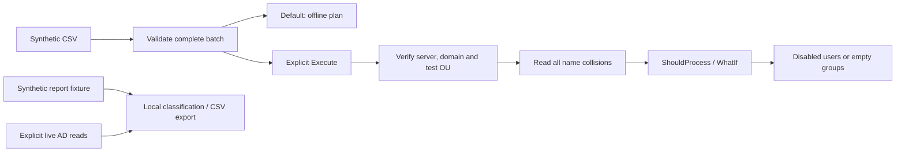

# Design and evidence limits

## Data flow

## Inactivity policy

Only enabled accounts are candidates. A populated last-logon value at or before the cutoff is classified as stale. An account without a logon value is considered a candidate only when its creation date is at or before the cutoff. Recently created and disabled accounts are excluded. The reference date is injectable for reproducible tests; CSV timestamps must include an offset, and inconsistent/future dates fail. The report never disables or deletes accounts.

Live mode uses `LastLogonDate` from the AD PowerShell module. This is a replicated, approximate signal, not an exact last authentication time across all domain controllers. Review business context and other sign-in evidence before making an account decision. This lab does not measure replication delays or query every DC's nonreplicated logon attribute.

## Membership policy

Report only direct members. A nested group remains a group row; it is not expanded into effective permissions. Empty groups receive an explicit row. A group may contain a member outside the target OU, so exported member identities must still be treated as private directory data.

## Failure behavior

CSV validation and collision preflight complete before the first creation call. Once writes begin, failures stop processing and can leave earlier successes. Keep the emitted object GUIDs, inspect the directory, and clean up only confirmed newly created lab objects. A concurrent creation between preflight and write can still cause a collision. Reruns are intentionally conservative: an existing name causes a failure, not an automatic repair or deletion.

Output files are not overwritten. A report with no result rows produces a clear exception and no file; the caller can inspect returned objects without requesting a file. No telemetry, credential storage, remote installation, endpoint configuration or host-domain join is performed by these scripts.

## Tested versus pending

Local tests cover CSV rejection, offline plans, scope restrictions, inactivity cutoff/never-logon handling, direct membership, overwrite protection, spreadsheet escaping, and mocked directory command behavior. Command doubles validate program flow; they cannot validate AD schemas, permissions, network reachability, server versions, replication or actual provisioning.

PowerShell 7.6.5 was used for the recorded local run. The Windows PowerShell 5.1 test invocation was blocked by the host's script execution policy; that policy was not changed or bypassed. Windows PowerShell 5.1 and the real ActiveDirectory module remain unverified here. No claim of cross-version compatibility is made from syntax alone.

## Primary references

- [New-ADUser](https://learn.microsoft.com/en-us/powershell/module/activedirectory/new-aduser?view=windowsserver2025-ps): creation parameters and disabled-account behavior.
- [New-ADGroup](https://learn.microsoft.com/en-us/powershell/module/activedirectory/new-adgroup?view=windowsserver2025-ps): group scope/category and target path.
- [Get-ADUser](https://learn.microsoft.com/en-us/powershell/module/activedirectory/get-aduser?view=windowsserver2025-ps): explicit property and search-scope retrieval.
- [Get-ADGroupMember](https://learn.microsoft.com/en-us/powershell/module/activedirectory/get-adgroupmember?view=windowsserver2025-ps): direct versus recursive membership.
- [CmdletBinding](https://learn.microsoft.com/en-us/powershell/module/microsoft.powershell.core/about/about_functions_cmdletbindingattribute?view=powershell-7.5): `SupportsShouldProcess` and confirmation behavior.
